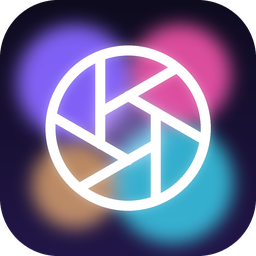

<p align="center"></p>

<h1 align="center">OpenBokeh</h1>

<p align="center"><b>Câmera com IA e gravação de tela para Windows: grátis, livre e feita para funcionar em placas AMD, NVIDIA e Intel.</b></p>

<p align="center">
  <a href="https://github.com/cleversonmeyer/OpenBokeh/releases/latest"></a>
  
  
</p>

*Read in English: [README.md](README.md)* · [Histórico de versões](CHANGELOG.md) · [Privacidade](PRIVACIDADE.md)

---

## Por que existe
Quem tem placa de vídeo **AMD** não tinha um programa gratuito e bom para desfocar ou trocar o fundo da
webcam: o NVIDIA Broadcast só funciona em placas NVIDIA. O OpenBokeh usa a IA **Robust Video Matting** pela
**DirectML** (DirectX 12). Por isso roda na placa de vídeo de qualquer fabricante, e sem placa de vídeo roda
no processador.

## Baixar e instalar
1. Baixe o **`OpenBokeh-Setup.exe`** na página de [versões (Releases)](https://github.com/cleversonmeyer/OpenBokeh/releases/latest).
2. Rode o instalador. Ele pede permissão de administrador para instalar a câmera virtual.
3. Abra o OpenBokeh pelo menu Iniciar.

> **Aviso do Windows ("O Windows protegeu o computador")**: o instalador ainda não tem assinatura digital
> (ela é paga ou depende de aprovação de um programa para projetos livres). Clique em **Mais informações ›
> Executar assim mesmo**. Para conferir se o arquivo é o original, compare o SHA-256 publicado junto com a
> versão: no PowerShell, `Get-FileHash .\OpenBokeh-Setup.exe`.

**Requisitos:** Windows 10 ou 11 (64 bits). Recomendada uma placa de vídeo com DirectX 12 (AMD Radeon, NVIDIA
GeForce, Intel Arc/Iris). Sem ela, o app usa o processador, com menos quadros por segundo.

Para remover: Configurações do Windows › Aplicativos › OpenBokeh › Desinstalar.

## O que ele faz

### 📷 Câmera para chamadas
- **Fundo desfocado, imagem, vídeo em loop, cor sólida** ou sem efeito, com recorte da pessoa sem "halo".
- **Câmera virtual própria, "OpenBokeh Camera"**, para escolher no Google Meet, Zoom, Teams, Discord, OBS:
  - a clássica (DirectShow, 64 e 32 bits);
  - no Windows 11, também a do padrão novo, vista pelo app Câmera, pelos apps da Store e pelo novo Teams.
- **Correção de luz** (clareia o rosto no escuro), **redução de ruído** da imagem e **retoque de pele**.
- **Enquadramento automático**: zoom suave que acompanha você.
- **Câmera redonda**: só um círculo, com verde em volta para o Chroma Key do OBS.
- **"Volto já"** (Ctrl+Alt+B): congela e desfoca a imagem com um aviso, sem desligar a câmera na chamada.
- **Perfis**: Reunião, Ambiente escuro, Apresentação, Chroma verde, Câmera redonda ou os seus.
- **Microfone sem ruído** (opcional): tira ventilador, teclado e barulho de rua com a IA RNNoise. Para usar
  nas chamadas é preciso o cabo virtual gratuito [VB-CABLE](https://vb-audio.com/Cable/), porque o Windows não
  permite criar um microfone sem driver.

### 🖥 Gravação de tela
- **O que gravar**: a tela inteira, uma **região** marcada com o mouse (Shift = 16:9) ou uma **janela** (Chrome,
  VS Code…). Se a janela mudar de lugar ou de tamanho, o vídeo acompanha.
- **Formato 16:9** (1080p ou 1440p) ou o nativo do monitor. Monitor ultrawide (21:9) vira 16:9 sem perder a nitidez.
- **Encaixe**:
  - **com faixas**: tudo aparece, com as bordas desfocadas;
  - **preencher**: sem faixas, cortando as bordas;
  - **1:1**: tamanho real.
- **Sua webcam por cima**: círculo, retângulo ou **só você**, sem fundo, com o efeito atual da câmera.
- **Áudio**:
  - microfone escolhido na própria página, com redução de ruído e medidor ao vivo (não precisa do VB-CABLE);
  - **som do computador** junto.
- **Texto nítido**: a tela entra em 1:1 sempre que possível, com cores corretas (BT.709) e codificação na placa de
  vídeo (H.264 ou HEVC). Medido: nitidez do texto 0,999 (SSIM). O tamanho do arquivo, com texto rolando a 60 fps,
  depende do preset:

  | Preset | Codificação | Tamanho |
  |---|---|---|
  | Edição | H.264 | ~2,6 GB/h |
  | Alta | HEVC | ~1,4 GB/h |
  | Compacta | HEVC | ~1,2 GB/h |

- **Controles**: contagem 3-2-1 e mini barra flutuante (cronômetro, pausar, parar). A mini barra e as janelas do
  OpenBokeh **não aparecem no vídeo**.
- **Proteções**: o app confere o espaço em disco. Se o Windows bloquear a pasta Vídeos ("acesso controlado a
  pastas"), ele grava em "Gravações OpenBokeh" e avisa.

### ⚙ Do dia a dia
- Ícone na bandeja, iniciar com o Windows, e modo espera: sem nenhum app usando a câmera, a webcam desliga.
- Avisos claros quando a webcam está ocupada, desconectada ou bloqueada pela privacidade do Windows.
- Português e inglês (segue o idioma do Windows).

## Atalhos (configuráveis)
| Atalho | Ação |
|---|---|
| Ctrl+Alt+B | Volto já (tela de privacidade) |
| Ctrl+Alt+N | Liga/desliga o efeito |
| Ctrl+Alt+R | Inicia/para a gravação de tela |
| Ctrl+Alt+P | Pausa/retoma a gravação |
| Ctrl+Alt+S | Para a gravação |
| Ctrl+, | Configurações |

## Privacidade
Tudo acontece **no seu computador**: nenhuma imagem, som ou vídeo é enviado para a internet. Não há conta,
anúncio nem telemetria. Detalhes em [PRIVACIDADE.md](PRIVACIDADE.md).

## Problemas comuns
- **A câmera não aparece no app de chamada**: feche e abra o app (ou recarregue o Meet). Persistindo,
  Configurações › Câmera virtual › Reparar.
- **Não grava na pasta Vídeos**: é o "acesso controlado a pastas" do Windows. O app grava em "Gravações OpenBokeh";
  para liberar Vídeos: Segurança do Windows › Proteção contra ransomware › Permitir um aplicativo.
- **Algo deu errado**: Ajuda › Copiar diagnóstico e abra uma [issue](https://github.com/cleversonmeyer/OpenBokeh/issues)
  com o arquivo `openbokeh.log` (fica em `%APPDATA%\OpenBokeh`).

## Como funciona (técnico)
- **IA**: Robust Video Matting (MobileNetV3) em ONNX, FP16 na placa de vídeo via onnxruntime-directml (FP32 na CPU).
  O modelo tem memória entre quadros, então a borda não treme.
- **Câmeras virtuais**:
  - `camera_virtual/`: filtro DirectShow adaptado do [Unity Capture](https://github.com/schellingb/UnityCapture) (MIT);
  - `camera_mf/`: fonte Media Foundation do Windows 11.
  - O app envia os quadros por memória compartilhada.
- **Gravação** (`gravador/`): uma DLL nativa faz tudo na placa de vídeo:
  - captura da tela (DXGI Desktop Duplication);
  - composição com a webcam em shader D3D11;
  - conversão RGB→NV12 BT.709;
  - codificação pela Media Foundation, com o codificador da placa (AMD AMF, NVENC, QuickSync), em MP4;
  - captura do som do PC (WASAPI loopback).
- **Microfone**: RNNoise (Xiph, BSD) compilado em `audio_rnnoise/`.

## Desenvolvimento
Precisa de Windows 10/11 e Python 3.10+.
```
instalar.bat                      (cria o venv e instala as dependências)
iniciar.bat                       (abre o app pelo código)
```
As DLLs nativas são compiladas com o [Zig](https://ziglang.org) 0.13 (funciona a partir do Linux/WSL):
`camera_virtual/compilar.sh`, `camera_mf/compilar.sh`, `gravador/compilar.sh` e `audio_rnnoise/compilar.sh`.

Instalador (versões exatas em `requirements-build.txt`):
```
venv\Scripts\python -m pip install -r requirements-build.txt
venv\Scripts\python empacotar\construir.py      (gera dist\OpenBokeh-Setup.exe e confere o conteúdo)
```
Testes automáticos: `venv\Scripts\python -m unittest discover -s testes -v`

Textos: todo texto da interface usa `_()`. A tradução para inglês fica em `traducoes_en.py`, e a chave é o texto
em português. Opções de linha de comando: `--listar`, `--camera "nome da webcam"`, `--cpu`, `--sem-janela`,
`--bandeja`, `--benchmark 300`.

Contribuições são bem-vindas, veja [CONTRIBUTING.md](CONTRIBUTING.md). Falhas de segurança: [SECURITY.md](SECURITY.md).

## Licença e créditos
O OpenBokeh é software livre sob a **GNU GPL versão 3 ou posterior** ([LICENSE](LICENSE)), compatível com o modelo de
IA que ele usa. Componentes de terceiros e licenças: [TERCEIROS.md](TERCEIROS.md), também na janela **Sobre** do app.

AMD e Radeon são marcas da Advanced Micro Devices, Inc.; NVIDIA, da NVIDIA Corporation; Intel, da Intel Corporation.
O OpenBokeh é um projeto independente, sem vínculo com essas empresas.
