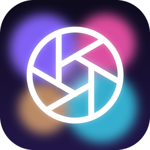

<p align="center"></p>

<h1 align="center">OpenBokeh</h1>

<p align="center"><b>AI camera and screen recorder for Windows: free, open source, and built to work on AMD, NVIDIA and Intel graphics.</b></p>

<p align="center">
  <a href="https://github.com/cleversonmeyer/OpenBokeh/releases/latest"></a>
  
  
</p>

*Leia em português: [LEIAME.md](LEIAME.md)* · [Changelog](CHANGELOG.md) · [Privacy](PRIVACY.md)

---

## Why it exists
People with **AMD** graphics had no good free app to blur or replace the webcam background, because NVIDIA
Broadcast only runs on NVIDIA cards. OpenBokeh runs the **Robust Video Matting** AI through **DirectML**
(DirectX 12), so it works on any vendor's GPU, and on the CPU when there is no GPU.

## Download and install
1. Download **`OpenBokeh-Setup.exe`** from the [Releases](https://github.com/cleversonmeyer/OpenBokeh/releases/latest) page.
2. Run it. It asks for administrator permission to install the virtual camera.
3. Open OpenBokeh from the Start menu.

> **"Windows protected your PC"**: the installer is not code-signed yet. Click **More info › Run anyway**.
> To check that the file is the original, compare its SHA-256 with the one published with the release:
> `Get-FileHash .\OpenBokeh-Setup.exe` in PowerShell.

**Requirements:** Windows 10 or 11 (64-bit). A DirectX 12 GPU (AMD Radeon, NVIDIA GeForce or Intel Arc/Iris) is
recommended. Without one, the CPU is used, at a lower frame rate.

To uninstall, go to Windows Settings › Apps › OpenBokeh › Uninstall.

## Features

### 📷 Camera for calls
- **Blurred background, image, looping video, solid color** or no effect, with a clean, halo-free cutout.
- **Its own virtual camera, "OpenBokeh Camera"**, for Google Meet, Zoom, Teams, Discord and OBS:
  - a classic DirectShow one (64 and 32 bits);
  - on Windows 11, a modern one for the Camera app, Store apps and the new Teams.
- **Light correction**, **image noise reduction** and **skin retouch**.
- **Auto framing**: a smooth zoom that follows you.
- **Round camera**: just a circle, with green around it for OBS chroma key.
- **"Be right back"** (Ctrl+Alt+B): freezes and blurs the image without turning the camera off.
- **Profiles** (meeting, dark room, presentation, green screen, round camera, or your own).
- **Noise-free microphone** (optional): removes fan, keyboard and street noise with RNNoise. Using it in calls
  needs the free [VB-CABLE](https://vb-audio.com/Cable/), because Windows does not allow a microphone without a driver.

### 🖥 Screen recording
- **What to record**: the whole screen, a **region** drawn with the mouse (Shift = 16:9), or a **window** that the
  video follows when it moves or is resized.
- **16:9 output** (1080p or 1440p) or the monitor's native size. Ultrawide (21:9) monitors become 16:9 without losing
  sharpness.
- **Fit**:
  - **with bars**: everything shows, with blurred edges;
  - **fill**: no bars, the edges are cropped;
  - **1:1**: actual size.
- **Your webcam on top**: circle, rectangle, or **just you**, with no background, using the current camera effect.
- **Audio**:
  - a microphone chosen on the page itself, with noise removal and a live level meter (VB-CABLE not needed);
  - **computer sound** too.
- **Sharp text**: the screen goes in at 1:1 whenever possible, with correct colors (BT.709) and GPU encoding (H.264 or
  HEVC). Measured text sharpness is 0.999 (SSIM). File size with scrolling text at 60 fps depends on the preset:

  | Preset | Codec | Size |
  |---|---|---|
  | Editing | H.264 | ~2.6 GB/h |
  | High | HEVC | ~1.4 GB/h |
  | Compact | HEVC | ~1.2 GB/h |

- **Controls**: a 3-2-1 countdown and a floating mini bar (timer, pause, stop). The mini bar and the OpenBokeh windows
  **never show up in the video**.
- **Safeguards**: the app checks free disk space. If Windows blocks the Videos folder (controlled folder access), it
  records to "OpenBokeh Recordings" and tells you.

### ⚙ Everyday use
- Tray icon, start with Windows, and a standby mode that turns the webcam off when no app is using the camera.
- Clear messages when the webcam is busy, unplugged or blocked by Windows privacy settings.
- Portuguese and English, following the Windows language.

## Shortcuts (configurable)
| Shortcut | Action |
|---|---|
| Ctrl+Alt+B | Be right back (privacy screen) |
| Ctrl+Alt+N | Effect on/off |
| Ctrl+Alt+R | Start/stop screen recording |
| Ctrl+Alt+P | Pause/resume recording |
| Ctrl+Alt+S | Stop recording |
| Ctrl+, | Settings |

## Privacy
Everything happens **on your computer**: no image, sound or video is sent to the internet. There are no accounts,
ads or telemetry. Details are in [PRIVACY.md](PRIVACY.md).

## Troubleshooting
- **The camera does not show up in the call app**: restart the app (or reload Meet). If it still doesn't, go to
  Settings › Virtual camera › Repair.
- **Cannot record to the Videos folder**: this is Windows "controlled folder access". The app records to "OpenBokeh
  Recordings" instead. To allow Videos, go to Windows Security › Ransomware protection › Allow an app.
- **Something went wrong**: use Help › Copy diagnostics and open an [issue](https://github.com/cleversonmeyer/OpenBokeh/issues)
  with `openbokeh.log`, which is in `%APPDATA%\OpenBokeh`.

## How it works (technical)
- **AI**: Robust Video Matting (MobileNetV3) in ONNX. It runs in FP16 on the GPU via onnxruntime-directml, or FP32 on
  the CPU. Its memory between frames keeps the edges from flickering.
- **Virtual cameras**:
  - `camera_virtual/` holds a DirectShow filter adapted from [Unity Capture](https://github.com/schellingb/UnityCapture) (MIT);
  - `camera_mf/` holds the Windows 11 Media Foundation source;
  - frames reach them through shared memory.
- **Recording** (`gravador/`): a native DLL does all the work on the GPU:
  - DXGI Desktop Duplication captures the screen;
  - a D3D11 shader composes it with the webcam;
  - the video processor converts RGB to NV12 (BT.709);
  - Media Foundation encodes it with the GPU's own encoder (AMD AMF, NVENC or QuickSync) into MP4;
  - WASAPI loopback captures the computer sound.
- **Microphone**: RNNoise (Xiph, BSD), built in `audio_rnnoise/`.

## Development
You need Windows 10/11 and Python 3.10+.
```
instalar.bat                      (creates the venv and installs the dependencies)
iniciar.bat                       (runs the app from source)
```
The native DLLs are built with [Zig](https://ziglang.org) 0.13, which also works from Linux/WSL:
`camera_virtual/compilar.sh`, `camera_mf/compilar.sh`, `gravador/compilar.sh` and `audio_rnnoise/compilar.sh`.

To build the installer (exact versions are in `requirements-build.txt`):
```
venv\Scripts\python -m pip install -r requirements-build.txt
venv\Scripts\python empacotar\construir.py      (builds dist\OpenBokeh-Setup.exe and checks its contents)
```
To run the tests: `venv\Scripts\python -m unittest discover -s testes -v`

The code is written in Portuguese. Every UI string goes through `_()`, and English translations live in
`traducoes_en.py`, keyed by the Portuguese text. Command-line options: `--listar`, `--camera "webcam name"`, `--cpu`,
`--sem-janela`, `--bandeja`, `--benchmark 300`.

Contributions are welcome; see [CONTRIBUTING.md](CONTRIBUTING.md). To report a security issue, see [SECURITY.md](SECURITY.md).

## License and credits
OpenBokeh is free software under the **GNU GPL version 3 or later** ([LICENSE](LICENSE)), which matches the license of
the AI model it uses. Third-party components and their licenses are listed in [TERCEIROS.md](TERCEIROS.md) and in the
app's **About** window.

AMD and Radeon are trademarks of Advanced Micro Devices, Inc. NVIDIA is a trademark of NVIDIA Corporation, and Intel is
a trademark of Intel Corporation. OpenBokeh is an independent project with no affiliation to these companies.
